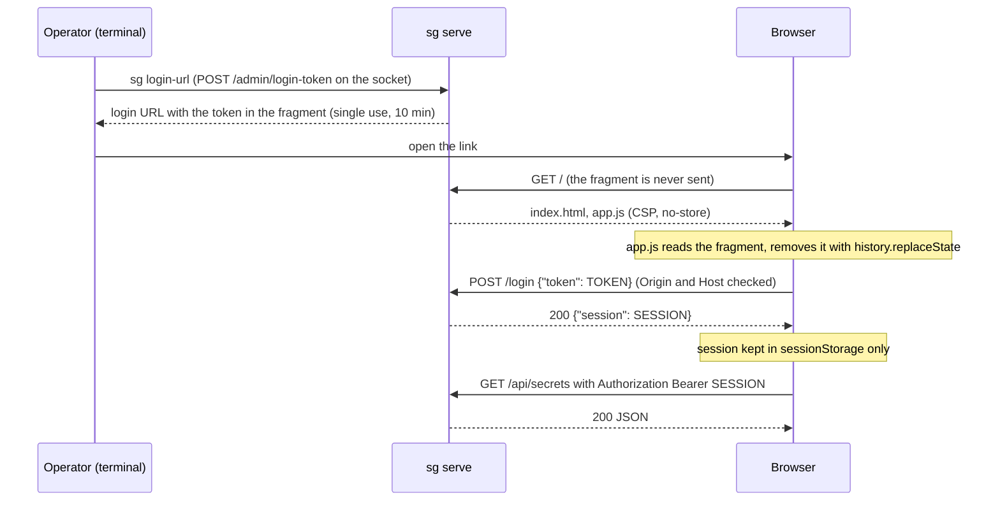

# Admin API

The JSON API that the CLI and the web UI use. It is served on **two listeners** with the same routes and
different authentication. Source: `crates/admin/src/{api,web,sessions,serve,error}.rs`; every example below was
obtained by calling a real `sg serve` with `curl --unix-socket` (socket) and `curl` plus the login flow (web).

You normally use the [CLI](cli-reference.md) or the [web UI](../README.md#web-ui). This page is for people writing
tooling against the API, auditing it, or debugging.

**Fixed rule: no route ever returns a secret value.** Secret values go in (`POST /secrets`, `PUT /secrets/{name}`)
and never come out; the admin crate does not call the decrypting function at all (a test greps the source for it).

## The two listeners

| | Unix socket | Web (loopback HTTP) |
|---|---|---|
| Address | `--socket` / `SG_SOCKET`, default `$XDG_RUNTIME_DIR/secret-guardian.sock`, mode `0600` | `--admin-bind`, default `127.0.0.1:9090` |
| Used by | `sg` CLI, `curl --unix-socket`, scripts | the browser UI |
| Authentication | None of its own: whoever can open the socket is the operator. The socket must be in a `0700` directory owned by the server's user (checked when binding and by the CLI client). | One-time login token in the URL fragment, exchanged by `POST /login` for a session; every `/api/*` call needs `Authorization: Bearer <session>` |
| Path prefix | none (`/secrets`) | `/api` (`/api/secrets`) |
| `POST /admin/login-token` | yes | **no** (404 behind the session check) |
| Host check | no | yes, `421` on mismatch |
| Origin check | no | yes, on `POST /login` and on every write under `/api` |
| Static UI | no | yes (`/`, `/app.js`, `/style.css`) |
| Security headers | no | yes, on every response |
| Connection limits | 256 concurrent, 10 s to send a request head, 1 h maximum connection lifetime | same |

Why two kinds of trust: a browser can be pointed at `127.0.0.1:9090` by any web page, so the web listener
needs real authentication and request validation; a Unix socket with mode `0600` cannot be reached by a web page
at all, and filesystem permissions are the strongest local credential available. The login-token route exists
only on the socket so the web listener can never mint its own credentials.

### Authentication on the web listener, step by step



Properties:

- The login token is 256 random bits (64 hex characters), single use, valid **10 minutes**, at most **8 pending**
  at once (the oldest is dropped). `sg serve` prints the first one on its `admin:` line; `sg login-url` makes more.
- A session is 256 random bits (64 hex characters), valid **8 hours** from login (no sliding renewal), at most
  **16 active** (the oldest is evicted). Only SHA-256 digests of tokens and sessions are kept, in memory:
  restarting the server logs everybody out.
- Unknown, already-used, expired and evicted login tokens are indistinguishable: all give the same `401`.
- **No cookies.** The session is an `Authorization: Bearer` header only; cookies are ignored entirely. Reason:
  browsers send host-only cookies to *every port* of `localhost` (RFC 6265 does not isolate ports), so another
  local web server the operator happens to visit, say on `http://localhost:3000`, would receive the session
  and could call the admin API. `sessionStorage` is isolated per origin including the port, and an
  `Authorization` header cannot be attached by a foreign page without a CORS preflight, which this server never
  answers (it sends no CORS headers at all). For the same reason there is no CSRF token: the credential is not
  ambient.
- The token travels in the URL **fragment**, which browsers never send to servers or in `Referer`; it is posted in a
  JSON body, so it appears in no URL, log or history. The server has no request-logging layer.

Reproduction with `curl` (the `Host` header must be one the server allows; with a real browser it is automatic):

```
$ TOKEN=$(sg --json login-url | jq -r .token)
$ curl -s -X POST -H 'Host: localhost:36655' -H 'Content-Type: application/json' \
       -d "{\"token\":\"$TOKEN\"}" http://127.0.0.1:36655/login
{"session":"302bf0737f4bf3c69b31080068a73e2e82cb8396dc04ea5f83edb505f5949be9"}
$ curl -s -H 'Host: localhost:36655' -H "Authorization: Bearer $SESSION" http://127.0.0.1:36655/api/secrets
[{"id":2,"name":"second","created_at":1792180581,"rotated_at":1792180581,"rules":1}, ...]
```

## Guards and their order

### Web listener

Outermost first. Each response also gets the [security headers](#security-headers).

| # | Guard | Applies to | Failure |
|---|---|---|---|
| 1 | **Host**: the `Host` header must equal (case-insensitively) one of `localhost:<port>`, `127.0.0.1:<port>`, `[::1]:<port>` or an `--admin-allowed-host` value. `Host: localhost` without port is refused. | every request, static files included | `421 Misdirected Request`, body `unexpected Host header` (plain text) |
| 2 | **Session** (`/api/*` only): exactly one `Authorization: Bearer <id>` header with a valid session. Any other form (two headers, other scheme, cookie only) is treated as missing. | `/api/*` | `401` `{"error":"login required: use the URL printed by `sg serve`"}` |
| 3 | **Origin** (writes under `/api`, and always on `POST /login`): a present `Origin` must be exactly `http://<allowed host>`; an absent `Origin` passes (curl, CLI-like clients). | `POST`/`PUT`/`DELETE` | `403` `{"error":"cross-origin request refused"}` |
| 4 | **JSON content type** (writes): `Content-Type: application/json` (parameters allowed). A body without a declared type is refused; a write with `Content-Length: 0` or no body at all is allowed. | non-GET/HEAD/OPTIONS | `415` `{"error":"content type must be application/json"}` |
| 5 | **Body limit**: 64 KiB. | all bodies | `413` `{"error":"request body too large"}` |
| 6 | **Strict bodies**: unknown fields are rejected (`deny_unknown_fields`), invalid JSON too. | JSON bodies | `400` `{"error":"invalid JSON body"}` |

The order matters: authentication comes **before** content-type and body checks, so an unauthenticated caller
learns nothing about them (`401` beats `415`). On `POST /login` the order is Host, Origin, content type, body limit,
then the handler.

A JSON content type on writes means a cross-site HTML form (which can only send `text/plain`,
`multipart/form-data` or `application/x-www-form-urlencoded`) cannot reach any state-changing route without a CORS
preflight.

### Socket listener

Only guards 4 to 6 apply (no Host, Origin or session checks). Unknown routes give `404`
`{"error":"not found"}` and wrong methods `405` `{"error":"method not allowed"}`. `HEAD` works like `GET`;
`OPTIONS` gives `405`.

### Security headers

On every response of the web listener (static files, API, errors):

| Header | Value |
|---|---|
| `Content-Security-Policy` | `default-src 'self'; script-src 'self'; style-src 'self'; img-src 'self' data:; frame-ancestors 'none'; base-uri 'none'; form-action 'self'` |
| `X-Content-Type-Options` | `nosniff` |
| `Referrer-Policy` | `no-referrer` |
| `Cache-Control` | `no-store` |
| `X-Frame-Options` | `DENY` |
| `Cross-Origin-Opener-Policy` | `same-origin` |
| `Cross-Origin-Resource-Policy` | `same-origin` |

No third-party resources, no inline scripts or styles, and no CORS headers are ever sent.

### Static files (web only)

`GET`/`HEAD` of `/` (served as `index.html`), `/app.js`, `/style.css`; the files are embedded in the binary from
`web/` at build time. Other methods give `405` (empty body), unknown paths `404` (empty body).

## Conventions

- Request and response bodies are JSON (`application/json`). Timestamps are Unix seconds (integers).
- Errors are `{"error": "<message>"}` with the status code shown. Messages are fixed strings meant for humans;
  internal details (SQL, file paths) are logged on the server's stderr and never returned: unexpected failures
  give `500` `{"error":"internal error"}`.
- Names in the path (`{name}`) are percent-decoded by the router and then validated.
- All routes below exist on both listeners; on the web listener prefix them with `/api`.
- Limits: request bodies 64 KiB; a secret value at most 8192 bytes, no CR/LF/NUL; names as stated; a machine
  label 1 to 128 characters without control characters; token lifetime at most 10 years; audit limit 1 to 1000.

## Routes

### Secrets

Metadata object (`SecretMeta`): `{"id": 3, "name": "api-key", "created_at": 1792180853, "rotated_at": null}`.
`GET /secrets` adds a `rules` count to each item. A secret is always created together with at least one rule (a
secret no rule uses can never be injected), so `rules` is at least 1 except for secrets created before that
invariant existed (see [operations.md](operations.md#upgrading-from-a-version-without-required-rules)).

| Method and path | Body | Success | Errors |
|---|---|---|---|
| `GET /secrets` | - | `200` array of `SecretMeta` plus `rules` (count), sorted by name | - |
| `POST /secrets` | `{"name", "value", "rules": [RuleSpec, ...]}` (`rules` required, 1 to 20 items) | `201` `{"secret": SecretMeta, "rules": [Rule, ...], "ca_changed": bool, "notice": null \| "<text>"}` | `400` `invalid name: use [a-z0-9._-], max 64 chars`; `400` `invalid secret value: empty` / `too long` / `contains control characters`; `400` `a secret needs at least one rule: ...` (missing or empty `rules`); `400` `too many rules for one secret (max 20)`; `400` any rule error (`unknown role`, `host_pattern must be ...`, template and path errors, `domain rejected: <reason>`); `409` `already exists`; `409` `an identical rule already exists (rule N)` (two equal rules in `rules`) |
| `GET /secrets/{name}` | - | `200` `SecretMeta` | `400` invalid name, `404` `not found` |
| `PUT /secrets/{name}` (rotate) | `{"value": "..."}` | `200` `SecretMeta` with `rotated_at` set | as above, `404` |
| `DELETE /secrets/{name}` | - | `204`; the secret's rules are deleted with it and the CA is re-synced | `404` |

`RuleSpec` is a rule without `secret_id` (the secret is the one being created): `{"role", "host_pattern",
"path_pattern"?: "*", "methods"?: [], "kind": "header"|"query", "target_name", "template"}`. Unknown fields are
rejected. The whole request is atomic: the secret, its rules and the CA certificate it implies are written in one
SQLite transaction, so any `400`/`409` leaves no secret, no rule and no CA change (and the response never reflects the
value). `ca_changed` is true when the permitted domains changed and the CA certificate was re-issued; `notice` then says
agents must reload it.

```
$ curl -s -i --unix-socket $SG_SOCKET -X POST -H 'content-type: application/json' \
       -d '{"name":"api-key","value":"s3cr3t-value","rules":[{"role":"reviewer","host_pattern":"api.example.org","methods":["GET"],"kind":"header","target_name":"Authorization","template":"Bearer {secret}"}]}' \
       http://localhost/secrets
HTTP/1.1 201 Created
content-type: application/json

{"ca_changed":true,"notice":"the CA certificate changed: agents must reload it (sg ca export)","rules":[{"host_pattern":"api.example.org","id":7,"kind":"header","methods":["GET"],"path_pattern":"*","role":"reviewer","secret_id":5,"target_name":"Authorization","template":"Bearer {secret}"}],"secret":{"created_at":1792417787,"id":5,"name":"api-key","rotated_at":null}}
```

Refusals (real responses):

```
$ curl -s -i ... -d '{"name":"nr","value":"v"}' http://localhost/secrets
HTTP/1.1 400 Bad Request

{"error":"a secret needs at least one rule: say which role, host and header or parameter it is injected into"}
$ curl -s -i ... -d '{"name":"nr","value":"v","rules":[{"role":"reviewer","host_pattern":"a.invalid","kind":"header","target_name":"X","template":"{secret}"}]}' http://localhost/secrets
HTTP/1.1 400 Bad Request

{"error":"domain rejected: reserved"}
```

### Roles

Role object: `{"name": "reviewer", "unmatched": "deny"}` (`unmatched` is `passthrough` or `deny`).

| Method and path | Body | Success | Errors |
|---|---|---|---|
| `GET /roles` | - | `200` array sorted by name | - |
| `POST /roles` | `{"name": "reviewer", "unmatched": "deny"}` (both required) | `201` role | `400` `role name must be [a-z0-9_-]`; `400` `invalid JSON body` (including a bad `unmatched`); `409` `already exists` |
| `DELETE /roles/{name}` | - | `204`; its rules are deleted too and the CA is re-synced | `404`; `409` `deleting this role would leave secrets without rules: <names>; ...` (up to 5 names, then `and N more`; nothing is deleted) |

### Rules

Rule object: `{"id", "role", "host_pattern", "path_pattern", "methods": [...], "kind": "header"|"query",
"target_name", "template", "secret_id"}`. An empty `methods` array means any method.

| Method and path | Body | Success | Errors |
|---|---|---|---|
| `GET /rules[?role=<name>]` | - | `200` array ordered by id | `400` invalid role filter or unknown query parameter (`invalid query string`) |
| `POST /rules` | `{"role", "host_pattern", "path_pattern"?: "*", "methods"?: [], "kind", "target_name", "template", "secret_id"}` | `201` `{"rule": {...}, "ca_changed": bool, "notice": null \| "<text>"}` | `400` with the policy message (for example `unknown role`, `unknown secret`, `host_pattern must be a lowercase hostname or *.hostname (no IPs)`, `domain rejected: <reason>` (the CA cannot permit the host; nothing is created), template and path errors, listed in [policy-and-rules.md](policy-and-rules.md#21-validation-storers-validate)); `409` `an identical rule already exists (rule N)` |
| `DELETE /rules/{id}` | - | `204`; the CA is re-synced | `400` `invalid rule id` (not a positive integer); `404`; `409` `this is the last rule of its secret: delete the secret instead, or add another rule first` |

Creating the rule and re-deriving the CA's permitted domains happen in one transaction. `ca_changed` is true (and `notice`
is `the CA certificate changed: agents must reload it (sg ca export)`) when the host was new to the CA. A rule for a host
the CA already permits returns `"ca_changed": false, "notice": null`. Deleting a rule re-derives the domains too (a host
no rule uses any more is dropped from the CA), without a notice.

```
$ curl -s -i --unix-socket $SG_SOCKET -X POST -H 'content-type: application/json' \
       -d '{"role":"reviewer","host_pattern":"api.example.org","kind":"query","target_name":"k","template":"{secret}","secret_id":5}' \
       http://localhost/rules
HTTP/1.1 201 Created

{"ca_changed":false,"notice":null,"rule":{"host_pattern":"api.example.org","id":8,"kind":"query","methods":[],"path_pattern":"*","role":"reviewer","secret_id":5,"target_name":"k","template":"{secret}"}}
$ curl -s -i --unix-socket $SG_SOCKET -X DELETE http://localhost/roles/default
HTTP/1.1 409 Conflict

{"error":"deleting this role would leave secrets without rules: gl; delete them or give them rules for another role first"}
```

### Tokens

| Method and path | Body | Success | Errors |
|---|---|---|---|
| `GET /tokens` | - | `200` array, newest first: `{"jti","machine","role","created_at","expires_at","revoked_at"}` (nulls where unset); never the token text | - |
| `POST /tokens` | `{"machine": "laptop", "role": "reviewer", "ttl_secs"?: 43200}` | `201` `{"token": "<jwt>", "jti", "machine", "role"}`: the **only** time the token is returned | `400` `machine must be 1-128 characters without control characters`; `400` `ttl_secs must be at most 10 years (315360000)`; `400` `unknown role` (also for a malformed role name); `400` `invalid JSON body` (for example negative `ttl_secs`) |
| `DELETE /tokens/{jti}` | - | `204` | `400` `invalid token id` (not a UUID); `404` `not found` (unknown **or already revoked**) |
| `POST /machines/{machine}/revoke` | none (no body needed) | `200` `{"revoked": N}` (N may be 0) | `400` machine label invalid |

`ttl_secs` omitted or `null` means no expiry. The API accepts `0`, which yields a token that is already expired;
the CLI refuses it.

### Certificate authority

The CA's permitted domains are **derived from the rules** (`*.x` becomes `x`); they cannot be set through the API.
`POST /ca/domains` no longer exists (it answers `404`; the web UI and the CLI have no "allow domain" action either).

| Method and path | Body | Success | Errors |
|---|---|---|---|
| `GET /ca` | - | `200` `{"domains": ["api.example.org", "gitlab.com"]}` (read-only, sorted) | - |
| `GET /ca/cert` | - | `200`, `Content-Type: application/x-pem-file`, the public CA certificate in PEM | - |

### Audit

| Method and path | Body | Success | Errors |
|---|---|---|---|
| `GET /audit[?limit=&role=&host=&since=]` | - | `200` array, newest first, of `{"ts","jti","machine","role","host","method","path","rule_id","decision","status"}` | `400` `limit must be between 1 and 1000`; `400` `invalid host filter` (empty, over 253 bytes or control characters); `400` invalid role; `400` `invalid query string` (unknown parameter or non-numeric `since`/`limit`) |

`limit` defaults to 100 when omitted. `since` is a Unix timestamp (`ts >= since`). Paths in the log never include
the query string. The meaning of `decision` values is in [proxy-internals.md](proxy-internals.md#audit-decisions).

### Socket only: `POST /admin/login-token`

Mints a single-use web login token (the same mechanism as the one printed by `sg serve`).

```
$ curl -s -i --unix-socket $SG_SOCKET -X POST http://localhost/admin/login-token
HTTP/1.1 200 OK
content-type: application/json
cache-control: no-store

{"token":"e6be5a3471ca2c13c9b5eef2e8cf5570e12fc38718623525a79d810c6f62557d","url":"http://localhost:36655/#t=e6be5a3471ca2c13c9b5eef2e8cf5570e12fc38718623525a79d810c6f62557d"}
```

`url` is present when the server knows its web base URL (always, under `sg serve`). Via the web listener the same
path (`/api/admin/login-token`) is `404`; `GET` on the socket gives `405`.

### Web only: `POST /login`

Trades a login token for a session (see above).

| Request | Response |
|---|---|
| `POST /login` `{"token": "<64 hex>"}` with `Content-Type: application/json`, `Host` allowed | `200` `{"session": "<64 hex>"}` with `Cache-Control: no-store` |
| unknown, used, expired or malformed token | `401` `{"error":"invalid or already used login token"}` (the token is never echoed) |
| body that is not `{"token": "..."}` | `400` `{"error":"invalid JSON body"}` |
| foreign `Origin` | `403` `cross-origin request refused` |
| not JSON | `415`; body over 64 KiB `413` |
| any other method (for example `GET /login`) | `404` `not found`, with an `Allow: POST` header |

## Status codes at a glance

| Code | Meaning in this API |
|---|---|
| `200` | OK with a JSON body |
| `201` | Created (secret with its rules, role, rule, token) |
| `204` | Done, no body (delete, revoke) |
| `400` | Validation failed or the JSON is malformed |
| `401` | Web only: no valid session, or bad login token |
| `403` | Web only: cross-origin write |
| `404` | Unknown route or object (also `/api/admin/login-token` on the web listener, `GET /login`) |
| `405` | Wrong method on a known route |
| `409` | Duplicate name; an identical rule already exists; deleting the last rule of a secret; deleting a role that would leave secrets without rules |
| `413` | Body over 64 KiB |
| `415` | Write without `application/json` |
| `421` | Web only: unexpected `Host` |
| `500` | Unexpected internal failure (`internal error`) |

## Notes for implementers

- Rule changes, token revocation and new CA domains take effect immediately in the proxy: it reads the database
  on every request (rules) or every tunnel (CA).
- A write that changes the CA's domains prepares the new certificate (key signing and a self-check) while the vault's
  database connection is locked, so the proxy waits a few milliseconds on that one request. See
  [architecture.md](architecture.md#admin-operations-and-the-ca).
- The API is synchronous SQLite behind one mutex; it is meant for one operator.
- The web UI is a thin client over exactly these routes; see [README: Web UI](../README.md#web-ui).
