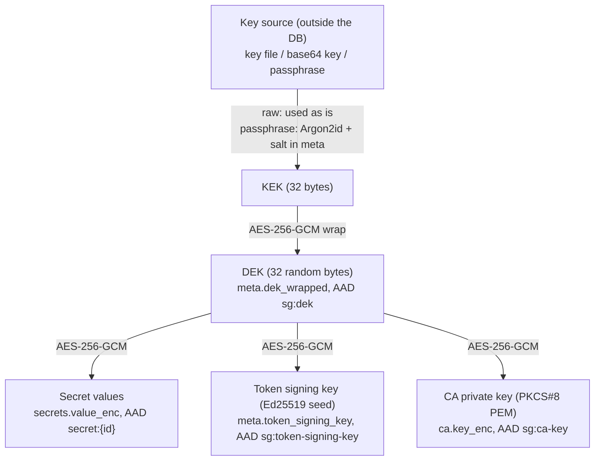

# Cryptography and keys

This page documents the key hierarchy, the encryption format, every AAD in use, zeroization practice
and its limits, failure modes, and what an attacker holding different pieces can and cannot do.
Sources: `crates/core/src/crypto.rs`, `crates/core/src/vault.rs`, `crates/core/src/secrets.rs`,
`crates/auth/src/token.rs`, `crates/ca/src/service.rs`. See also [database-schema.md](database-schema.md).

## 1. Key hierarchy

### 1.1 KEK sources

`KeyInput` (`crates/core/src/vault.rs`) has two variants:

| Variant | How the KEK is obtained | Stored in `meta` |
|---|---|---|
| `KeyInput::Raw(Key32)` | The 32 bytes are the KEK. Callers build them with `crypto::kek_from_base64(s)`: standard base64 (with padding), surrounding whitespace trimmed, must decode to exactly 32 bytes, else `CoreError::InvalidKey`. | `kdf = "raw"`, `salt` = empty blob |
| `KeyInput::Passphrase(String)` | `crypto::kek_from_passphrase`: Argon2id, 16-byte random salt generated at `init`. | `kdf = "argon2id"`, `salt` = the 16 bytes |

The three user-facing sources of the spec (key file `--key-file`/`SC_KEY_FILE`, env var
`SC_MASTER_KEY`, passphrase prompt) map onto those two variants: key file and env var both yield a
base64 32-byte key (`Raw`), the passphrase yields `Passphrase`. The code that reads them is in
`crates/sg/src/keys.rs` (`resolve_key`): exactly one source must be given; a key file must have no group/other
permission bits (mode `0600`); `SC_MASTER_KEY` is read from the environment only (never a flag); the passphrase is
prompted on a terminal (twice when the vault is first created). `sc keygen --out FILE` writes a new random key
(base64, mode `0600`, never overwrites). `sg-core` itself only offers `kek_from_base64` and `kek_from_passphrase`.

**Argon2id parameters** (`crypto.rs`, `argon2id()`), fixed explicitly so a crate default change cannot
alter derived keys:

| Parameter | Value |
|---|---|
| Algorithm / version | Argon2id, version 0x13 |
| Memory cost `m` | 19 MiB (`19 * 1024` KiB) |
| Time cost `t` | 2 passes |
| Parallelism `p` | 1 lane |
| Output length | 32 bytes |
| Salt | 16 random bytes (`OsRng`), stored in `meta.salt` |

The unit test `passphrase_kdf_known_answer_pins_the_parameters` pins the output for passphrase
`correct horse` and salt `[7; 16]` to `7132e6a6...0d7307`, so any change of parameters fails the test.
Remember these are Argon2 parameters at the low end of common recommendations (they are what the code
uses); the strength of a passphrase vault is bounded by the passphrase.

### 1.2 DEK

At `Vault::init` a random 32-byte DEK is drawn from `OsRng` and stored as
`seal(KEK, aad = "sg:dek", DEK)` in `meta.dek_wrapped`. All other encrypted values use the DEK. Because
of this layer, changing the KEK would only require re-wrapping 32 bytes (see
[key rotation](#6-key-rotation-status)).

## 2. Encryption format

`crypto::seal(key, aad, plaintext)` and `crypto::open(key, aad, blob)`:

- Cipher: **AES-256-GCM** (`aes-gcm` crate).
- Nonce: **96 bits, random per call** (`OsRng`), never derived from the data.
- Blob layout: `nonce (12 bytes) || ciphertext || tag (16 bytes)`. A sealed blob is therefore
  `plaintext_len + 28` bytes (test `blob_format_is_nonce_then_ciphertext_and_tag`).
- `open` rejects blobs shorter than 28 bytes, and returns one opaque error (`CoreError::Crypto`) for
  any failure: wrong key, wrong AAD, tampering or truncation (test `open_failures_are_a_single_opaque_error`).
- The AAD is authenticated but not stored; the caller must supply the same bytes to open.

With random 96-bit nonces under one key (the DEK), GCM's birthday bound applies to the number of
encryptions under that key. At the scale of this tool (a handful of secrets, a few rotations) it is
irrelevant, but it is a property of the chosen construction.

## 3. Every AAD in use

Found by grepping every call of `seal`, `open`, `seal_value` and `open_value`:

| AAD (bytes) | Defined in | Sealed with | Protects | Created | Read |
|---|---|---|---|---|---|
| `sg:dek` | `vault.rs`, `DEK_AAD` | KEK (`crypto::seal`) | The DEK (`meta.dek_wrapped`) | `Vault::init` | `Vault::open` |
| `secret:{id}` (e.g. `secret:7`) | `secrets.rs`, `aad(id)` | DEK (`seal_value`) | One secret value (`secrets.value_enc`) | `add_secret`, `rotate_secret` | `reveal_for_injection` |
| `sg:token-signing-key` | `auth/src/token.rs`, `KEY_AAD` | DEK | The Ed25519 seed (`meta.token_signing_key`) | `TokenService::new` (first run) | `TokenService::new` |
| `sg:ca-key` | `ca/src/service.rs`, `KEY_AAD` | DEK | The CA private key PEM (`ca.key_enc`) | `CaService::init_or_load` (first run) | `CaService::init_or_load` |

Properties that follow: a blob cannot be moved between rows or between purposes (a `secret:1` blob
does not open as `secret:2`; a signing-key blob does not open as `sg:other`; tests
`seal_open`/`open_with_wrong_aad_fails` in `crypto.rs`, `signing_key_is_bound_to_its_aad` in
`crates/auth/tests/tokens.rs`, `private_key_is_not_recoverable_from_the_db_without_the_vault_key` in
`crates/ca/tests/ca.rs`). `rotate_secret` re-seals under the same `secret:{id}` with a fresh nonce.

The spec (section 4) also states that the AAD is a purpose string, not just the record id: `sg:dek`,
`secret:{id}`, `sg:token-signing-key`, `sg:ca-key`.

## 4. What lives under each key

| Key | Protects |
|---|---|
| Key source (KEK) | Only the DEK. |
| DEK | Secret values, the token signing key, the CA private key. |
| Token signing key (Ed25519, 32-byte seed) | Authenticity of every agent token (see [tokens-and-ca.md](tokens-and-ca.md)). Not used for encryption. |
| CA private key (ECDSA key generated by `rcgen::KeyPair::generate`, PKCS#8 PEM) | Signs the CA certificate itself (self-signed) and every leaf certificate. |

Leaf keys are generated per host and live only in memory in the leaf cache (never persisted).

## 5. Zeroization practice and its honest limits

What the code does:

- Keys are `Key32 = Zeroizing<[u8; 32]>`: the KEK, the DEK held by `Vault`, the Ed25519 seed read in
  `TokenService::new` (`Zeroizing`), and temporary buffers returned by `open`/`open_value`
  (`Zeroizing<Vec<u8>>`).
- Base64-decoded key bytes are wrapped in `Zeroizing` before conversion (`kek_from_base64`).
- `reveal_for_injection` returns `Zeroizing<String>`; the proxy renders into `Zeroizing<String>` and
  drops the resolved values right after sending the upstream request (`forward.rs`,
  `drop(resolved)`).
- The injected `HeaderValue` is marked sensitive (`set_sensitive(true)` in `inject.rs`), which affects
  how `http`/`hyper` print or index it, not how memory is handled.

What it cannot guarantee:

- **Copies outside `Zeroizing`.** The injected value is copied into a `HeaderValue` (or the request
  URI for query injection), hyper's write buffers and rustls' record buffers; those are not wiped.
  `sg_policy::render` builds an intermediate `String` (for header kind it is `secret.to_string()`)
  that is dropped without wiping. `KeyInput::Passphrase(String)` is a plain `String`, not wiped by
  `sg-core`; the base64 string handed to `kek_from_base64` belongs to the caller.
- **Long-lived secrets in memory.** The DEK lives for the life of the process. The CA key
  (`rcgen::KeyPair`) and the Ed25519 `SigningKey` are held for the life of their services; whether
  their `Drop` wipes memory is up to those crates (this repository does not add a wrapper).
  `CaService::init_or_load` creates the PEM `String` with `key.serialize_pem()` on first run without
  wrapping it in `Zeroizing`.
- **No memory locking, no core-dump control.** The code does not call `mlock`, does not disable core
  dumps or ptrace, and does not set `PR_SET_DUMPABLE`. Swapping, core dumps or a debugger can expose
  the DEK or an in-flight secret. This is not mitigated here.
- **The allocator and the stack.** Moves of non-`Zeroizing` values leave copies; zeroization is
  best effort, not a proof.

## 6. Key rotation status

| Operation | Supported today? |
|---|---|
| Rotate a secret value (`Vault::rotate_secret`) | Yes: new ciphertext, same AAD, `rotated_at` set. |
| Change the passphrase or key file (re-wrap the DEK under a new KEK) | **No.** No function in `sg-core` does it; `meta.dek_wrapped`, `kdf` and `salt` are only written by `init`. The spec says the design allows it cheaply (only the DEK is re-wrapped) but that rotation is not implemented in phase 1. |
| Rotate the DEK (re-encrypt every secret, signing key, CA key) | **No.** |
| Rotate the token signing key | **No.** Generated once; deleting the `meta` row by hand would invalidate every issued token (and is not supported by any API). |
| Rotate the CA key | **No.** Changing the CA's domains (they follow the rules) re-issues the certificate with the **same** key. |
| Switch between raw key and passphrase | **No**: `kdf` is fixed at init. |

## 7. Failure modes

| Situation | Result |
|---|---|
| Wrong key (raw) or wrong passphrase, same kind as the vault | `CoreError::WrongKey` (message "wrong key or corrupted vault") |
| Key kind differs from the vault (`Raw` for an `argon2id` vault or the reverse) | `CoreError::KeySourceMismatch` ("the vault was created with a different key source") |
| `meta.kdf`, `salt` or `dek_wrapped` missing, `salt` not 16 bytes, or unwrapped DEK not 32 bytes | `CoreError::WrongKey` |
| Base64 key not decodable or not 32 bytes | `CoreError::InvalidKey` (before any DB access) |
| Argon2 failure | `CoreError::Crypto` |
| Ciphertext tampered, truncated, or moved to another row/purpose | `CoreError::Crypto` from `open_value` (secret: `reveal_for_injection` fails, the proxy answers `502` "secret unavailable" and audits `upstream-error`) |
| Signing key blob decrypts but is not 32 bytes | `AuthError::Core(CoreError::Crypto)` |
| Corrupted `domains` JSON or CA key PEM | `CaError::Tls(..)` |
| Decrypted secret is not valid UTF-8 | `CoreError::Crypto` |

`WrongKey` vs `KeySourceMismatch` distinguishes only the *kind* of key source, which is visible
in plaintext `meta.kdf` anyway; a wrong value of the right kind and a corrupt file give the same
`WrongKey`. The spec says the failure reason is not revealed: `sc serve` honours that by printing the same
`could not unlock the vault with the given key source` for `WrongKey`, `KeySourceMismatch`, `InvalidKey` and `Crypto`
(`open_error` in `crates/sg/src/serve.rs`); only the library error types distinguish them.

## 8. What an attacker with X can do

| Attacker has | Can | Cannot |
|---|---|---|
| **A copy of the DB only** (all of `.db`, `-wal`, `-shm`) | Read all plaintext metadata: secret names, role names, rules (hosts, paths, methods, header names, templates), token metadata and token hashes, the full audit log, the public CA certificate and its permitted domains. Brute-force the key source offline: for a `raw` key this is infeasible (256-bit); for a passphrase vault the salt and Argon2id parameters are in the file, so the passphrase can be guessed offline (cost: 19 MiB x 2 passes per guess). | Recover any secret value, the token signing key (so cannot forge tokens) or the CA key (so cannot mint trusted leaves). Cannot move ciphertext between rows to change what a rule injects (AAD). |
| **DB + key source** (key file/env value, or the passphrase) | Everything: unwrap the DEK, decrypt every secret, forge valid agent tokens (they also need a `tokens` row, which an attacker with write access to the DB can insert), and sign leaf certificates with the CA key. The CA name constraints still limit which names a conforming client will accept from it. | Nothing is withheld. |
| **Running process memory** (debugger, core dump, swap, same-user `ptrace`) | Read the DEK, the signing seed, the CA key and any secret being injected; with the DEK, decrypt the DB. The code applies `zeroize` best effort but does not prevent this (section 5). | Without the DB file, nothing persistent; but live access is equivalent to DB + key. |
| **The CA key only** (e.g. from a leaked backup of `ca.key_enc` that was decrypted, or process memory) | Sign leaf certificates for names inside the CA's permitted subtrees (the permitted domains, derived from the rules, or `invalid` if there are none). Clients that honour name constraints will reject anything else, and DNS constraints plus the excluded `0.0.0.0/0` and `::/0` IP ranges block IP-address certificates. A MITM position on the victim's network is still required. | Impersonate hosts outside the permitted domains toward conforming clients; read the vault's secrets; forge agent tokens. Clients that do not enforce name constraints (the spec lists this as a risk) are not protected: the constraint is only as good as the client. |
| **A valid agent token** (no DB access) | Make requests through the proxy with the permissions of its role until it expires or is revoked. | Read secret values (the API never returns them and the proxy overwrites agent-supplied credentials), or reach hosts the role's `Unmatched`/rules do not allow. |
| **Write access to the DB file, no key** | Delete or alter rows (denial of service, change rules and roles, insert audit/token rows, flip `revoked_at`). Rule changes apply live to open tunnels. | Create valid ciphertext (needs the DEK) or valid tokens (needs the signing key). |

Spec success criterion 4 ("a DB copied without the master key reveals no secret") holds for secret
values, as shown by `database_file_never_contains_plaintext_secret`; this page spells out that metadata
is not covered.
