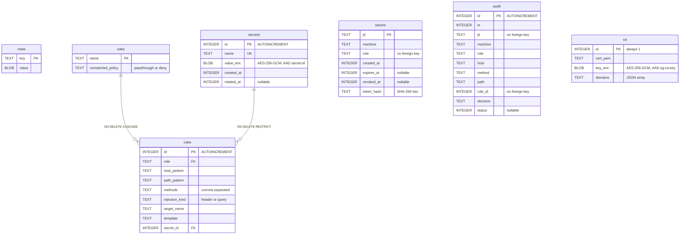

# Database schema

Secret Guardian stores everything in one SQLite file. The schema is the constant `SCHEMA` in
`crates/core/src/schema.rs`; it is applied once, by `Vault::init` (`crates/core/src/vault.rs`).
This page lists every table and column, who writes and reads it, what is encrypted (and with which
AAD), and what the code does on failure. See also [architecture.md](architecture.md) and
[crypto-and-keys.md](crypto-and-keys.md).

## 1. Entity-relationship diagram

`tokens`, `audit` and `meta` have no foreign keys. `tokens.role`, `audit.role`, `audit.jti` and
`audit.rule_id` are plain values: deleting a role, rule or token does not touch them, and they may
refer to rows that no longer exist. That is deliberate for the audit log (history survives deletions).

## 2. Tables

Timestamps are Unix seconds (`sg_core::now`, `i64`). SQLite opens with `PRAGMA foreign_keys = ON` on
every `Vault::init` and `Vault::open`.

### 2.1 `meta`

`key TEXT PRIMARY KEY, value BLOB NOT NULL`. Key/value store for vault-wide settings. See the
[key inventory](#3-meta-key-inventory).

### 2.2 `secrets`

| Column | Type / constraints | Meaning |
|---|---|---|
| `id` | `INTEGER PRIMARY KEY AUTOINCREMENT` | Stable identifier; part of the AAD (`secret:{id}`) and referenced by `rules.secret_id`. Never reused. |
| `name` | `TEXT NOT NULL UNIQUE` | Human name. Validated in `validate_name`: 1 to 64 bytes of `[a-z0-9._-]`. Plaintext. |
| `value_enc` | `BLOB NOT NULL` | `nonce(12) || ciphertext || tag(16)` of the secret value, AAD `secret:{id}`. |
| `created_at` | `INTEGER NOT NULL` | Creation time. |
| `rotated_at` | `INTEGER` (nullable) | Time of the last `rotate_secret`; `NULL` if never rotated. |

- Writers: `Vault::add_secret` (insert with `value_enc = x''`, then update with the real ciphertext in
  the same transaction, because the AAD needs the generated `id`), `rotate_secret` (updates
  `value_enc`, `rotated_at`), `remove_secret` (delete; refused with `CoreError::InUse` while any rule
  references the secret).
- Readers: `list_secrets` and `get_secret_meta` (metadata only, never `value_enc`),
  `reveal_for_injection` (decrypts; the proxy only), `sg_policy` validation (`SELECT COUNT(*) ... WHERE id`).
- Value constraints (`validate_secret_value`): non-empty, at most 8192 bytes, no CR, LF or NUL.

### 2.3 `roles`

| Column | Type / constraints | Meaning |
|---|---|---|
| `name` | `TEXT PRIMARY KEY` | Role name; `add_role` allows 1 to 64 bytes of `[a-z0-9_-]`. |
| `unmatched_policy` | `TEXT NOT NULL CHECK (IN ('passthrough','deny'))` | What to do for hosts with no rule (see [policy-and-rules.md](policy-and-rules.md)). |

- Writers: `sg_policy::add_role`, `remove_role` (deleting a role cascades to its rules).
- Readers: `get_role`, `list_roles` (policy); the proxy calls `get_role` at every CONNECT.
- There is no `UPDATE` path for a role's policy in the code.

### 2.4 `rules`

| Column | Type / constraints | Meaning |
|---|---|---|
| `id` | `INTEGER PRIMARY KEY AUTOINCREMENT` | Rule id; recorded in `audit.rule_id`; ties are broken by lowest id. |
| `role` | `TEXT NOT NULL REFERENCES roles(name) ON DELETE CASCADE` | Owning role. |
| `host_pattern` | `TEXT NOT NULL` | Exact lowercase hostname or `*.hostname`. |
| `path_pattern` | `TEXT NOT NULL` | `*`, an exact normalized path, or a normalized prefix ending in `*`. |
| `methods` | `TEXT NOT NULL` | Comma-separated upper-case methods; empty string means any method. |
| `injection_kind` | `TEXT NOT NULL CHECK (IN ('header','query'))` | Where the value is injected. |
| `target_name` | `TEXT NOT NULL` | Header name or query parameter name. |
| `template` | `TEXT NOT NULL` | Contains `{secret}`; for `query` it is exactly `{secret}`. |
| `secret_id` | `INTEGER NOT NULL REFERENCES secrets(id) ON DELETE RESTRICT` | The secret to inject. |

- Writers: `sg_policy::add_rule` (after `validate`), `remove_rule`; cascade deletes via `remove_role`.
- Readers: `list_rules` (the proxy loads the role's rules at CONNECT and again for every request);
  `Vault::remove_secret` (`COUNT(*) ... WHERE secret_id`).
- Validation rules are in [policy-and-rules.md](policy-and-rules.md).
- Everything in this table is plaintext.

### 2.5 `tokens`

| Column | Type / constraints | Meaning |
|---|---|---|
| `jti` | `TEXT PRIMARY KEY` | UUID v4 of the token (claim `jti`). |
| `machine` | `TEXT NOT NULL` | Machine label (claim `sub`). |
| `role` | `TEXT NOT NULL` | Role the token grants. No foreign key. |
| `created_at` | `INTEGER NOT NULL` | Issue time (claim `iat`). |
| `expires_at` | `INTEGER` (nullable) | Expiry (claim `exp`); `NULL` = no expiry. |
| `revoked_at` | `INTEGER` (nullable) | Set by `revoke` / `revoke_machine`. |
| `token_hash` | `TEXT NOT NULL` | Lower-case hex SHA-256 of the full token string. |

- Writers: `TokenService::issue` (insert), `revoke` and `revoke_machine` (set `revoked_at` where it is `NULL`).
- Readers: `TokenService::verify` (`SELECT revoked_at WHERE jti`), `TokenService::list` (everything except `token_hash`).
- `token_hash` is written but **never read** by any code in the repository: verification looks up by `jti`.
  The token itself is never stored; the test `stored_hash_is_sha256_hex_and_never_the_token`
  (`crates/auth/tests/tokens.rs`) checks that.

### 2.6 `audit`

| Column | Type / constraints | Meaning |
|---|---|---|
| `id` | `INTEGER PRIMARY KEY AUTOINCREMENT` | Order of insertion; listing is `ORDER BY id DESC`. |
| `ts` | `INTEGER NOT NULL` | Event time. |
| `jti`, `machine`, `role` | `TEXT` (nullable) | Identity of the caller; each truncated to 256 bytes. |
| `host` | `TEXT NOT NULL` | Destination host (normalized by the proxy); truncated to 253 bytes. |
| `method` | `TEXT NOT NULL` | HTTP method (`CONNECT` for tunnel events); truncated to 16 bytes. |
| `path` | `TEXT NOT NULL` | Request path **without** query or fragment; truncated to 2048 bytes. |
| `rule_id` | `INTEGER` (nullable) | Id of the first (lowest id) rule that matched, if any. |
| `decision` | `TEXT NOT NULL` | Outcome label (list in [architecture.md](architecture.md)); truncated to 64 bytes. |
| `status` | `INTEGER` (nullable) | HTTP status returned or observed. |

- Writer: `Vault::record_audit` (called by the proxy). It strips `?...`/`#...` again from the path
  (defence in depth), bounds every field, and uses the single connection.
- Reader: `Vault::list_audit` with `AuditFilter` (`role`, `host`, `since`, `limit`: 0 means 100, capped at 1000).
- Index: `audit_ts ON audit(ts)`. Filters on `role` and `host` are not indexed.
- The audited `path` is the raw request path (not the normalized one) minus the query string.
- There is no retention or pruning in the code: the table grows without bound.

### 2.7 `ca`

| Column | Type / constraints | Meaning |
|---|---|---|
| `id` | `INTEGER PRIMARY KEY CHECK (id = 1)` | Exactly one row. |
| `cert_pem` | `TEXT NOT NULL` | The public CA certificate in PEM. |
| `key_enc` | `BLOB NOT NULL` | CA private key (PKCS#8 PEM text) sealed under the DEK, AAD `sg:ca-key`. |
| `domains` | `TEXT NOT NULL` | JSON array of allowed domains (`[]` initially). |

- Writer: `CaService::init_or_load` (insert on first run), `CaService::allow_domain` (updates `cert_pem`, `domains`).
- Reader: `CaService::init_or_load`.

## 3. `meta` key inventory

The only inserts into `meta` in the code base are in `Vault::init_created` and `TokenService::new`.

| Key | Written by | Value | Encrypted? |
|---|---|---|---|
| `schema_version` | `Vault::init` | ASCII decimal of `SCHEMA_VERSION` (`b"1"`) | No |
| `kdf` | `Vault::init` | `b"raw"` (key file / base64 key) or `b"argon2id"` (passphrase) | No |
| `salt` | `Vault::init` | 16 random bytes for Argon2id; empty blob for `raw` | No |
| `dek_wrapped` | `Vault::init` | `nonce(12) || ciphertext(32) || tag(16)` of the DEK under the KEK, AAD `sg:dek` | Yes (under the KEK) |
| `token_signing_key` | `TokenService::new` on first use | `nonce || ciphertext || tag` of the 32-byte Ed25519 seed, AAD `sg:token-signing-key`; written with `INSERT OR IGNORE` so concurrent first creators converge on one key | Yes (under the DEK) |

`dek_wrapped` is the first thing `Vault::open` decrypts. `token_signing_key` does not exist until the
first `TokenService::new` call, so a freshly initialised vault has four `meta` rows and gains the fifth
the first time the token service starts.

## 4. What is plaintext and what is ciphertext

| Data | Where | Form |
|---|---|---|
| Secret values | `secrets.value_enc` | Ciphertext (AAD `secret:{id}`) |
| Token signing key (Ed25519 seed) | `meta.token_signing_key` | Ciphertext (AAD `sg:token-signing-key`) |
| CA private key | `ca.key_enc` | Ciphertext (AAD `sg:ca-key`) |
| The DEK | `meta.dek_wrapped` | Ciphertext under the KEK (AAD `sg:dek`) |
| Secret names, ids, created/rotated times | `secrets` | Plaintext |
| Role names and `unmatched_policy` | `roles` | Plaintext |
| Rule host/path patterns, methods, header/query target names, templates | `rules` | Plaintext. Templates such as `Bearer {secret}` contain no secret. |
| Token metadata: `jti`, machine, role, times, SHA-256 of the token | `tokens` | Plaintext |
| Audit rows (identity, host, method, path without query, decision, status) | `audit` | Plaintext |
| Public CA certificate and the list of allowed domains | `ca` | Plaintext (public by nature) |
| KDF name and Argon2 salt | `meta` | Plaintext |

Consequence: a copy of the database file, without the key source, reveals the vault's structure
(which hosts and paths have rules, secret names, who made which request to which host) but no secret
value, no token signing key and no CA private key. The test `database_file_never_contains_plaintext_secret`
(`crates/core/tests/vault.rs`) checks that a marker value is absent from every file in the data directory.

## 5. File permissions, WAL and SHM files

- `Vault::init_with` creates the database file with `OpenOptions::create_new(true).mode(0o600)` **before**
  SQLite opens it, so it is never created with broader permissions. `create_new` also means `init`
  fails with an I/O error if the file already exists (nothing is deleted in that case).
- `init` sets `PRAGMA journal_mode = WAL`. SQLite then creates `<db>-wal` and `<db>-shm` next to the
  database. SQLite gives these sidecar files the permissions of the main file; the test
  `wal_and_shm_files_are_private_while_open` asserts mode `0600` on whichever of them exist while
  the vault is open. The WAL can contain recent committed pages that have not yet been checkpointed
  into the main file; treat all three files as one unit (all ciphertext-only for secrets, as above).
- The directory that holds the file is not created or chmod-ed by `sg-core`. `paths::default_data_dir`
  only computes a path (`$XDG_DATA_HOME/secret-guardian`, else `$HOME/.local/share/secret-guardian`, else
  `/tmp/secret-guardian`; empty or relative variables are ignored). Creating and securing the directory
  is done by `sg serve` (`prepare_data_dir` in `crates/sg/src/serve.rs`): it creates the directory and any missing
  parents with mode `0700`, tightens a looser directory it owns (`note: tightened <dir> to mode 0700`) and refuses
  one owned by another user.
- `Vault::open` never creates a file: if the path does not exist it returns `CoreError::Io` (kind
  `NotFound`) and creates nothing, and it opens SQLite with `SQLITE_OPEN_READ_WRITE` only (no `CREATE`
  flag). `Vault::open_or_init` calls `init` when the path does not exist.

## 6. Initialisation and failure behaviour

`Vault::init` (via `init_with` and `init_created`):

1. Create the file (`0600`, must not exist).
2. Derive the KEK: for a raw key, use it as is and store an empty salt; for a passphrase, draw a
   16-byte random salt and run Argon2id.
3. Draw a random 32-byte DEK and wrap it under the KEK with AAD `sg:dek`.
4. Open the connection, set `journal_mode=WAL` and `foreign_keys=ON`.
5. In **one transaction**: run `SCHEMA`, insert the four `meta` rows, run the optional `before_commit`
   hook (used only by tests to inject a failure), commit.

If anything after step 1 fails, `init_with` calls `remove_db_files`, which deletes the main file and its
`-wal` and `-shm` files (ignoring errors), so a failed init leaves no partial vault and a retry with
the same path works. The unit test `failed_init_leaves_no_files_and_retry_succeeds` in `vault.rs`
asserts exactly that. Because the schema and meta rows share a transaction, a half-initialised vault
(tables without `dek_wrapped`) is never visible, even after a crash during init (SQLite rolls back).

`Vault::open`:

1. If the path does not exist, return `CoreError::Io(NotFound)`. Otherwise open with
   `SQLITE_OPEN_READ_WRITE` (no create) and set `foreign_keys=ON`.
2. Read `kdf` from `meta`. A missing row yields `CoreError::WrongKey`.
3. The `kdf` must match the supplied `KeyInput` variant (`raw` with `Raw`, `argon2id` with `Passphrase`),
   otherwise `CoreError::KeySourceMismatch`.
4. Read `salt` (for `argon2id`; it must be 16 bytes, else `WrongKey`), derive the KEK.
5. Read `dek_wrapped` and decrypt with AAD `sg:dek`; failure or a DEK that is not 32 bytes gives
   `CoreError::WrongKey`.
6. Only after the key is verified, read `schema_version`; a value that differs from `SCHEMA_VERSION`,
   is missing or is not numeric gives `CoreError::UnsupportedSchema { found, supported }` (a wrong key
   never reaches this step, so it does not leak the version).

`open` does not run `PRAGMA integrity_check`, and does not set
`journal_mode` (WAL is a persistent property of the file, set at init). A file that is not an SQLite
database, or has no `meta` table, produces `CoreError::Db`.

## 7. Versioning and migration status

`SCHEMA_VERSION` is `1` and is written to `meta.schema_version` at init. `Vault::open` reads it back
after the key is verified and refuses any other value with `CoreError::UnsupportedSchema`, which
`sg serve` reports at start-up as `database schema version N is not supported by this build (supports 1)` and exits
with status 1 (`open_error` in `crates/sg/src/serve.rs`); the server never starts on such a file. There is no migration framework and no
`ALTER TABLE` in the code. As the code stands:

- A vault created by a future version that changed the schema is refused by this code with
  `UnsupportedSchema` instead of failing later.
- A vault created by this version and opened by a future version depends entirely on that version
  implementing the check. Spec section 3 lists "migraciones" among the responsibilities of `core`; this
  is not implemented yet.

No upgrade or downgrade path is promised by this document.

## 8. Backup and restore (what the code implies)

- Restoring a vault requires **both** the database and the key source that created it: either the key
  file / base64 key (`kdf = raw`) or the passphrase (`kdf = argon2id`; the salt is inside the DB). The
  DEK is random and exists only wrapped in `meta.dek_wrapped`; without the KEK it cannot be recovered,
  and every secret value, the token signing key and the CA key depend on it. There is no recovery path.
- The database alone does not reveal secrets (section 4); the key alone is useless without the DB.
  Store them separately.
- The vault is opened in WAL mode: the consistent state is the main file together with `-wal`/`-shm`.
  A raw copy of only the main file while the process is running can miss committed data that is still in
  the WAL (observed: a freshly started server had a 4096-byte `vault.db` and a 70 KB `-wal`). The program has no
  backup command. What works: stop the server and copy the files, or take an online copy through SQLite's backup
  API (verified with Python's `sqlite3` module against a running server; a vault started from that copy had the same
  secrets, tokens and CA certificate). Exact commands, permissions to restore and audit pruning are in
  [operations.md](operations.md#backups).
- A restored database keeps its tokens, CA and signing key: previously issued tokens stay valid
  (subject to expiry and revocation) and agents do not need to reload the CA certificate. A different
  database, even with the same key, has a different DEK, signing key and CA.
- The `meta.kdf` row decides which key kind is required; supplying the wrong kind gives `KeySourceMismatch`
  and the wrong value gives `WrongKey` (see [crypto-and-keys.md](crypto-and-keys.md)).
