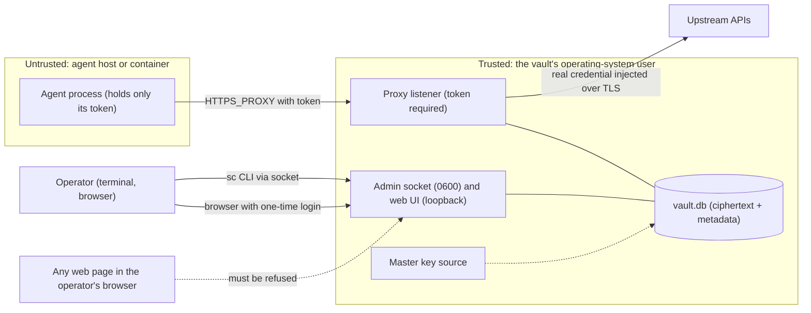

# Security model

What Secret Custodian protects, from whom, how, and what it deliberately does not do. Sections: [Assets](#assets) ·
[Trust boundaries](#trust-boundaries) · [Attacker models](#attacker-models) · [Mitigations mapped to code](#mitigations-mapped-to-code) ·
[Non-goals and residual risks](#non-goals-and-residual-risks) · [History of hardening](#history-of-hardening) ·
[Deployment checklist](#deployment-checklist).

Sources: the spec ([section 2](specs/2026-10-16-secret-guardian-vault.md), 6.2 assumptions A1 to A7, 6.3 "Red y
tuneles", 6.5, 7.2), the code under `crates/`, and the review history in `git log`. Where this page and the code
disagree, the code wins; please report it.

## The guarantee in one paragraph

An agent that is given a proxy URL and a token can make requests that carry real credentials, **within the
permissions of its role**, without ever holding or being able to read those credentials. No command, API route or
web page returns a stored secret value, secrets are encrypted at rest under a key that is not in the database, and
the agent's own attempts to supply a credential, widen a path, change the method, reach another host or the vault's
own interfaces are refused or neutralised. What it does **not** guarantee: that the agent cannot misuse what the role
allows, that an origin will not echo the credential back, or anything against an attacker who is already the same
operating-system user as the vault.

## Assets

| Asset | Where it lives | Protected by |
|---|---|---|
| Secret values (API keys, tokens) | `secrets.value_enc` in `vault.db` | AES-256-GCM under the data key, bound to `secret:{id}` |
| Master key (KEK) | Key file, `SC_MASTER_KEY`, or a passphrase | File mode `0600` (enforced), environment, human memory; never in the database |
| Data key (DEK) | `meta.dek_wrapped`, in memory while running | Wrapped under the KEK |
| Token signing key (Ed25519) | `meta.token_signing_key` | Sealed under the DEK |
| CA private key | `ca.key_enc` | Sealed under the DEK; certificate carries name constraints |
| Agent tokens | Held by the agent; SHA-256 digest in `tokens` | Signature, expiry, revocation |
| Policy: roles, rules, which secret goes where | `roles`, `rules` | Plaintext metadata in the DB (file mode `0600`); changes only via the admin API |
| Audit log | `audit` | Plaintext metadata, no secrets, no queries |
| Operator control of the vault | Admin socket (`0600`), web UI sessions | Filesystem permissions; one-time login tokens |

## Trust boundaries

The boundary that matters most is between the **agent** and the **vault's OS user**. The agent reaches the vault only
through the proxy port, holding a token; everything else (socket, database, key file, process memory) is reachable
only by the vault's own OS user. If the agent runs as that same OS user, the boundary does not exist (see
[co-located local process](#co-located-local-process)).

## Attacker models

### Malicious or compromised agent (including prompt injection)

Capabilities assumed: runs arbitrary code with its token and network access to the proxy; can craft any request.

| Can | Cannot |
|---|---|
| Make any request that one of its role's rules authorises, for as long as the token is valid (inherent in the model, spec section 2) | Read a secret value: nothing returns it, and the proxy overwrites any credential the agent sets for the same header or query parameter |
| Use a `passthrough` role to reach any host without rules, including private LAN addresses | Reach loopback, link-local/cloud metadata, multicast, the vault's own proxy and web ports (network policy); plain `http://` never carries an injected credential |
| Learn the shape of its role by trial (`403` versus success) | Exceed the rule's path prefix by traversal or encoding tricks (path judged at every decoding depth, the normalized path is forwarded whenever a path-restricted rule applies; non-ASCII paths are unjudgeable) |
| Exhaust its **own** budgets (64 tunnels, 64 concurrent upstream requests) | Starve other tokens (per-identity caps, global connection and upstream caps, idle and lifetime timeouts) |
| Send a `Host`, routing or forwarding header | Steer the injected request with them (`Host` must match the tunnel; method-override, `X-Forwarded-*`, `Via`, `X-Original-URL` and friends are stripped) |
| Ask for `TRACE`/`TRACK` to reflect credentials | Get them (`405`) |
| Ask for WebDAV `COPY`/`MOVE` with a `Destination` | Get them unless the rule names the method explicitly |
| Repeat a call after being revoked, inside an open tunnel | Succeed: the token is re-verified before every request |

Residual: query-string-based or body-based method overrides (for example `_method=DELETE`), a rule's `Destination`
header for explicit COPY/MOVE rules, and responses that echo the credential (see below).

### Malicious origin or response

An API that reflects the credential in its response body, `Location`, `Link` or `Content-Location` (common for
query-string keys) hands it to the agent. **Not defended** (spec 6.5): there is no response redaction. Prefer header
injection, use narrowly scoped upstream keys, and do not give agents a rule for hosts that echo credentials.
A redirect to a `http://` URL cannot leak the credential through the vault (nothing is injected over plain HTTP);
a redirect to another host that has a rule is subject to that rule.

### Co-located local process

| Process | Outcome |
|---|---|
| Other OS user | Cannot open the socket (`0600`, directory `0700`), the database or the key file (`0600`). The data directory is created `0700`. It can connect to the loopback proxy and web ports, where it needs a token or a one-time login token (256 bits) and, for the web UI, the right `Host` |
| **Same OS user** | **Total compromise**: it can read the key file and database, open the socket, read process memory (`ptrace`), and extract everything. Run agents as a different user or in a container; never as the vault's user |
| Another local web server (`http://localhost:3000`) the operator browses to | Cannot obtain a web session: no cookies are used, `sessionStorage` is per origin including port, and the API needs a bearer header |

### Malicious web page (in the operator's browser)

| Attack | Defence |
|---|---|
| DNS rebinding to `127.0.0.1:9090` | `Host` allowlist (`421` otherwise) on every request, static files included |
| Cross-site request forgery | State changes need `Content-Type: application/json` (a form cannot send it), an `Origin` that is exactly an allowed host, and an `Authorization: Bearer` header a foreign page cannot attach without a CORS preflight (never answered; no CORS headers) |
| Stealing a session cookie | There are none |
| Reading the login token | It lives in the URL fragment (not sent to servers or `Referer`), is removed by `history.replaceState`, single use, 10 minutes |
| XSS / script injection | CSP `default-src 'self'; script-src 'self'; style-src 'self'; frame-ancestors 'none'; base-uri 'none'`, no `innerHTML`/`eval`/inline handlers (checked by a test that scans `web/app.js`), values rendered as text |
| Clickjacking | `frame-ancestors 'none'` and `X-Frame-Options: DENY` |
| Probing the proxy port from a page | Needs a `Proxy-Authorization` header a page cannot set |

The web UI has **not been verified in a real browser** by the authors; these defences are checked by Rust tests
against the server and by `node` tests of the page logic, not by driving a browser (see [testing.md](testing.md)).

### Stolen database

An attacker with every file (`vault.db`, `-wal`, `-shm`) and no key reads **metadata**: secret names, role names,
rules (hosts, paths, templates), token metadata and digests, the whole audit log, the public CA certificate and
domains. Secret values, the signing key and the CA key are ciphertext. With a raw 256-bit key, brute force is
infeasible; with a passphrase vault the salt and Argon2id parameters (19 MiB, 2 passes, 1 lane) are in the file, so
the strength is the passphrase's. Details: [crypto-and-keys.md](crypto-and-keys.md#8-what-an-attacker-with-x-can-do).
A backup is exactly as sensitive as the database; keep the key separate.

### Stolen master key (or database plus key)

Everything: all secrets, forging tokens, signing certificates. Recovery is manual: rotate every upstream credential,
start a new vault. Rotation of the master key is not implemented ([operations.md](operations.md#key-management)).

### Stolen agent token

The thief has the role's permissions until the token expires or is revoked (`sc token revoke`, effective at the
next request in an open MITM tunnel; passthrough tunnels end by idle timeout or after at most 8 h). The audit log
attributes every request to the token id and machine label. Mitigations: short `--ttl`, one token per machine, narrow
roles, revoke on suspicion. The token is not bound to a source address.

#### Isolating agents that share a machine

A token is an identity, not a credential: stealing it never yields a secret value, only the permissions of its role
while it lives. But two agents running as the **same OS user** can read each other's environment
(`/proc/<pid>/environ`), shell history and files, so a `reviewer` agent could take the `developer` token. Real
isolation needs a boundary the kernel enforces. In order of practicality:

1. **One container per agent**, with the token only in that container's `-e HTTPS_PROXY=...`.
2. **A different OS user per agent** (`sudo -u agent-reviewer ...`), token only in that process's environment.
3. **A per-process sandbox** (`bubblewrap`, `systemd-run`) with its own PID namespace.
4. **Same user, damage control only:** keep the token out of files and history, use short `--ttl`, revoke when the
   session ends, and watch the audit log for a machine label doing something its role should not.

Phase 2b of the roadmap removes the token as a secret: the proxy would also listen on a Unix socket and derive the
role from the peer credentials (`SO_PEERCRED`), so there is nothing to steal. It requires distinct users or
containers per role and is not implemented yet (spec, section 10).

### Stolen CA private key

(Requires the database and key, or process memory.) The thief can sign certificates, but only for the CA's
permitted domains (X.509 name constraints) and never for IP addresses (all IPv4 and IPv6 ranges are excluded), and
needs a man-in-the-middle position on a victim that trusts this CA. Not every TLS library enforces name constraints;
those clients get no protection from them. The CA certificate should be trusted only by the processes that need it,
through environment variables, not in a system or browser store.

#### The CA follows the rules

The CA is no longer widened by hand: its permitted domains are **derived from the rules** (`*.x` becomes `x`) and
re-issued whenever that set changes, in the same transaction as the rule change. Two consequences matter for risk:

- **Creating a rule widens what the CA may sign for.** Anyone who can create a rule (the operator, via the socket or a
  logged-in web session) also decides which names this CA can vouch for; there is no separate approval step any more. A
  rule for `api.example.com` adds `api.example.com` to the name constraints; a stolen CA key (previous section) is then
  good for that host as well. Review rule hosts as you would review CA domains.
- **`*.x` permits `x` and every subdomain.** X.509 name constraints cannot express "subdomains only", so the wildcard rule
  `*.example.com` adds `example.com` to the constraints, which covers `example.com` and everything under it (the rule
  itself still matches only subdomains). The CA does not consult the Public Suffix List, so a rule for `*.github.io` or
  `*.co.uk` lets a stolen CA key sign for every site under that suffix. Write rules for exact hosts.

Removing the last rule that needed a host also removes it from the CA, so the CA shrinks as rules go. Agents that hold
an older certificate keep working after a removal; after an addition they must reload the certificate (`sc ca export`)
or they refuse the new name (see [tokens-and-ca.md](tokens-and-ca.md#24-re-issue-with-the-same-key)). Start-up drops
domains no rule uses.

### Malicious or compromised upstream network

Upstream TLS is verified with the system roots plus any `--upstream-ca` you added; a certificate failure is a `502`.
The destination is resolved once and the connection goes to a vetted address, so DNS rebinding between check and
connect is not possible. Private LAN addresses are allowed on purpose (homelab): a hostile name that resolves to
`192.168.x.x` can be reached by a `passthrough` role or by a rule's host. Use `deny` roles and exact-host rules.

## Mitigations mapped to code

| Threat | Mitigation | Where |
|---|---|---|
| Agent reads a secret | Library exposes only `SecretMeta`; the one decrypting call, `Vault::reveal_for_injection`, is used only by the proxy | `crates/core/src/secrets.rs`; `crates/proxy/src/forward.rs`; test `admin_never_references_reveal_for_injection` (`crates/admin/tests/hygiene.rs`); `no_route_ever_returns_a_secret_value` (`crates/admin/tests/api.rs`) |
| Secret on the command line, in history or `ps` | Value read from stdin or a hidden prompt, bounded, validated, scrubbed from error messages | `crates/cli/src/input.rs`, `commands.rs` |
| Secret in logs or error bodies | No request logging; tracing events carry no request data; error bodies are fixed strings | `crates/proxy/tests/no_leaks.rs`, `connect.rs` (`error_bodies_do_not_echo_tokens_or_secret_names`); `crates/sg/tests/cli_e2e.rs` |
| Stolen database | AES-256-GCM with a per-purpose AAD; key outside the DB; Argon2id for passphrases | `crates/core/src/crypto.rs`, `vault.rs`; [crypto-and-keys.md](crypto-and-keys.md) |
| Key file readable by others | `sc serve` refuses a key file with any group/other bit; `sc keygen` creates it `0600` and never overwrites | `crates/sg/src/keys.rs` |
| Database or directory readable by others | DB created `0600` before SQLite touches it; data dir `0700` (created or tightened; foreign owner refused) | `crates/core/src/vault.rs`; `crates/sg/src/serve.rs` (`prepare_data_dir`) |
| Another user reaches the admin socket | Socket `0600` in a `0700` directory owned by the server's user, checked by the server and by the client; a regular file or symlink at the path is refused; a live socket is never replaced | `crates/admin/src/serve.rs` (`bind_unix`); `crates/cli/src/client.rs` |
| Rebinding, CSRF, session theft, XSS, framing | See the web-page table | `crates/admin/src/web.rs`, `api.rs`, `sessions.rs`; `web/app.js` |
| Token forgery or reuse | EdDSA signature verified before claims; strict header; issuer; expiry; revocation row required | `crates/auth/src/token.rs` |
| Revoked token keeps working | Re-verified before every request in a MITM tunnel | `crates/proxy/src/mitm.rs` |
| Path escapes of a restricted rule | Normalize then judge every decoding depth; refuse dot-like segments under every separator model, control characters and every non-ASCII character (allowlist); forward the normalized path where a restricted rule applies; an unreadable rule set is a `503`, never "no rules" | `crates/policy/src/{normalize,matcher}.rs`; exhaustive oracle test |
| Method fallback to a broader rule | A method excluded from the most specific rule is `403`, no fallback | `crates/policy/src/matcher.rs` |
| Credentials over plain HTTP | Never injected, no exception | `crates/proxy/src/forward.rs` (`plaintext-refused`) |
| SSRF: loopback, metadata, link-local, vault ports | Network policy on the resolved address; own ports denied; wildcard binds expanded to interface addresses | `crates/proxy/src/upstream.rs` (`NetPolicy`); `crates/sg/src/serve.rs` |
| Tunnel reuse for another host | Host/authority must equal the CONNECT host (`421`) | `crates/proxy/src/forward.rs` |
| Routing and attribution overrides, reflection | Header strip list, `TRACE`/`TRACK`/`CONNECT` refused, COPY/MOVE need explicit methods | `crates/proxy/src/inject.rs`, `forward.rs` |
| Resource exhaustion | Connection cap, header and handshake timeouts, idle and lifetime bounds, per-identity caps, global upstream cap, body idle timeout | `crates/proxy/src/lib.rs`, `server.rs`, `mitm.rs`, `body.rs`, `ident.rs`; admin: `crates/admin/src/serve.rs` |
| Over-broad CA | Name constraints; `invalid` placeholder when empty; IP ranges excluded; webpki-compatible domain validation with a probe; single-label and TLD domains refused; domains derived from the rules (no manual widening), start-up sync drops domains no rule uses | `crates/ca/src/service.rs`; `crates/admin/src/ops.rs`; `crates/policy/src/domains.rs` |
| Corrupt or foreign database | Unsupported schema refused after the key is verified; wrong key gives a non-specific error | `crates/core/src/vault.rs`; `crates/sg/src/serve.rs` (`open_error`) |

## Non-goals and residual risks

Collected from the spec (sections 1, 2, 6.2 A1 to A7, 6.3, 6.5, 11) and from the code. These are known and accepted
for phase 1.

**Scope of the guarantee**

- An agent with proxy access acts with its role's permissions (inherent). Rules bound the damage; they do not
  prevent misuse of what they allow.
- Secrets reflected by the origin in a response are visible to the agent. No response redaction. Query-string keys
  are the worst case (`Link`, `Location`, `Content-Location`).
- There is no per-agent identity inside a machine label: any process that can read the token is that machine.
  The token is visible to the agent (environment variable). A sidecar/launcher that keeps it away is a planned
  phase.
- Single operator, no multi-user model, no roles for administrators, no remote login. The web UI is plain HTTP on
  loopback; a non-loopback `--admin-bind` only prints a warning.

**Protocol and client coverage**

- Injection is limited to request **headers and query parameters** over TLS. No body or signature injection
  (AWS SigV4, HMAC).
- No WebSockets or other `Upgrade` through the MITM (the headers are removed).
- Certificate-pinned clients, Java (own trust store) and programs that ignore the CA environment variables will not
  work with the MITM. Clients that do not enforce name constraints get no protection from them.
- Origins are reached over HTTP/1.1 only.

**Policy limits**

- The port is not part of a rule: a rule for `api.example.com` applies to every port of that host. This is why nothing
  is ever injected without TLS.
- Rules match the normalized hostname only. IP-address hosts cannot have rules.
- Paths are judged under assumptions A1 to A6 about origins (percent-decoding, separators, dot segments, Unicode);
  an origin outside them (for example one that folds some other Unicode character into `.`) is outside the guarantee.
  A catch-all `*` rule for the same destination also covers paths a restricted rule refuses to judge.
- Method overrides carried in the query or body (`_method=`) are not stripped; for explicit COPY/MOVE rules the
  `Destination` header is not validated against the rule's path.
- Only the id of the first matching rule is audited.
- The public suffix list is not consulted for CA domains: a rule for `*.github.io` or `*.co.uk` (or for such a host itself
  being a suffix) lets the CA sign for every site under it. Write rules for exact hosts.
- Revocation does not cut passthrough tunnels already open (bounded by 10 min idle and 8 h lifetime).

**Cryptography and memory**

- Decrypted secrets exist in memory only during injection, wiped best effort; copies inside hyper, rustls and the
  allocator are not wiped. The data key lives as long as the process. No `mlock`, no core-dump or `ptrace`
  hardening. Swap and core dumps can expose keys.
- No key rotation (master key, data key, signing key, CA key). Rotating a secret value is supported.
- The audit write is fail-open for requests already forwarded (an error is logged; the request is not undone).
- A write-capable attacker on the database file can alter rules, roles, tokens and audit rows (denial of service,
  policy change), though not create valid ciphertext or tokens.

**Availability**

- SQLite is accessed synchronously from async worker threads behind one mutex: a very busy proxy delays admin
  calls. Fine for one operator; not a multi-tenant design.
- The audit log is never pruned and grows without bound.

**Platform**

- Linux only as written: the program reads `/proc/self` to learn its user id, and uses Unix sockets, Unix file
  permissions and Unix signals. Other Unixes are untested and macOS fails closed (no `/proc`).
- The leaf certificate cache, per-identity counters and web sessions are in memory; a restart drops sessions and
  open tunnels.

## History of hardening

The project was built in review rounds; several issues found in review shaped the final design. Derived from `git log`
and the spec; commit ids are in the short form used by `git log --oneline`.

| Area | Issue found | How it was closed |
|---|---|---|
| Path judging (`3d6f202`, `b10ae13`, `78f7600`, `fe76575`, `0d29020`) | Encoded and double-encoded paths such as `..%2f`, `%252e%252e` and `;`-parameters could slip past a prefix rule; a method excluded from a narrow rule fell back to a broad one; successive patches (Unicode look-alikes, `+` as space) showed that imitating origin behaviour one by one does not converge | Redesigned: instead of imitating origins, accept a path only if no dot-like segment exists at any decoding depth under any separator model, refuse control characters and confusables, forward the normalized path, fail closed on method mismatch. An independent oracle that applies every sequence of five origin operations now proves, over about 1.5 million paths, that nothing escapes the prefix |
| Web sessions (`2ca1e19`) | Cookie sessions would be sent by browsers to every `localhost` port, so another local web server could read them; a CSRF header was needed to compensate | Sessions are bearer tokens in `sessionStorage`; login by URL fragment and `POST /login`; no cookies, no CSRF header; session and login tokens stored as digests and capped; connection limits; ownership checks of the socket and its directory; socket-only `POST /admin/login-token` so the web listener cannot mint credentials |
| Plain-HTTP injection (`687ff55`, `ac65f50`) | A first version injected into plain `http://` requests for `localhost`. Because rules do not include the port, any listener on another port of an allowed host would receive the credential | Removed with no exception: nothing is ever injected without TLS; a `localhost` rule works over TLS only |
| Tunnels and resources (`f520e33`, `687ff55`) | The first proxy implementation did not yet bound tunnel lifetime or idle and stalled peers, did not limit what one token may hold, forwarded routing and method-override headers, allowed `TRACE`, and could be pointed at loopback, cloud-metadata addresses and its own ports | Connection slot held for the tunnel's life; handshake, idle and lifetime bounds; stall detection in both directions; per-identity tunnel and upstream caps; body idle timeout; header strip list; `TRACE`/`TRACK`/`CONNECT` refused; network policy on resolved addresses incl. NAT64/6to4 embedded IPv4 and the proxy's own binds |
| CA names (`23859b4`) | DNS name constraints do not restrict IP-address SANs, and a domain that webpki would reject could make the whole CA unusable; the leaf cache was unbounded | All IP ranges excluded in the CA certificate; domains validated like webpki and probed before persisting; leaf cache bounded to 1024 entries |
| Tokens and keys (`d496d25`, `7fe2d00`, `aec303b`, `7bc66fd`) | Unbounded token lifetime, racy signing-key creation, Argon2 parameters inherited from crate defaults, database created before its mode was set, opening a missing vault created one, unknown schema versions accepted | TTL capped at 10 years; signing key converges under concurrency; Argon2id pinned with a known-answer test; DB created `0600` before SQLite opens it; `open` never creates; unsupported schema refused after the key is verified |

## Deployment checklist

Before giving an agent a token:

- [ ] The vault runs as its own OS user (or in a container); **agents run as a different user or container** and
      cannot read the key file, the data directory or the admin socket.
- [ ] Master key in a `0600` file (or a Docker secret / `SC_MASTER_KEY` set from a secret manager), backed up
      **separately** from the database. Know that losing it loses every secret.
- [ ] `--admin-bind` is loopback (or published only to the host's `127.0.0.1` in Docker). Never expose the web UI to
      a network; there is no remote login.
- [ ] The proxy port is reachable only from the agents (loopback, an internal Docker network, or a firewall rule).
      It requires a token but is not otherwise hardened for the open internet.
- [ ] Roles use `--unmatched deny` unless the agent genuinely needs unrestricted outbound access; rules name exact
      hosts, narrow path prefixes and the least methods (`GET` for read-only roles).
- [ ] Credentials injected by header, not query string; upstream keys are scoped to the minimum the role needs.
- [ ] Rule hosts (which become the CA's domains) are exact hosts you control or trust (`api.github.com`, not `*.github.io` or
      `*.co.uk`); `sc ca status` shows what the CA currently permits.
- [ ] The CA certificate is trusted only per agent process through the environment variables, not in a system store
      or browser.
- [ ] Tokens have a `--ttl`, one token per machine and role; revoke (`sc token revoke`, `revoke-machine`) when a
      machine is retired or suspected.
- [ ] You know your upstreams: none that reflect credentials in responses are used with agents you do not trust.
- [ ] `sc audit` is reviewed periodically; the database is backed up; plan for audit growth (there is no built-in
      pruning).
- [ ] Binary and image come from your own build of a reviewed commit; the Docker image runs as uid 10001 with a
      read-only root filesystem, no capabilities and `no-new-privileges` (see the compose example).
- [ ] Host clock is correct (token expiry and certificate validity depend on it).
